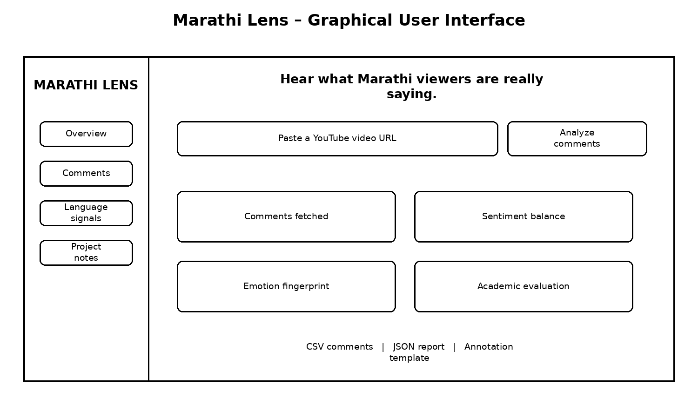
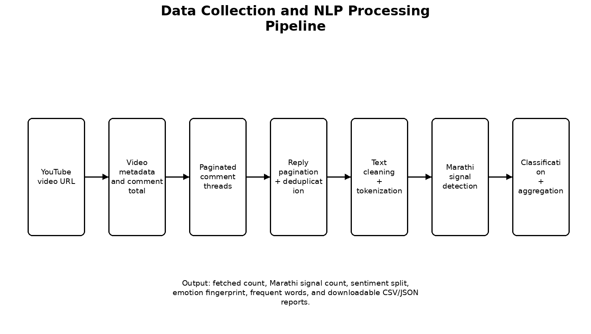
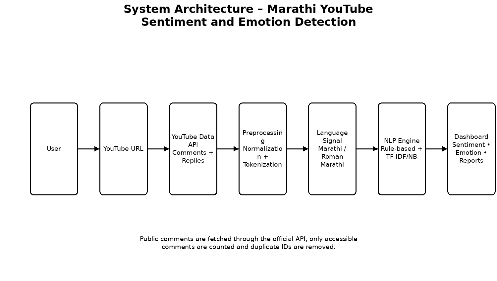
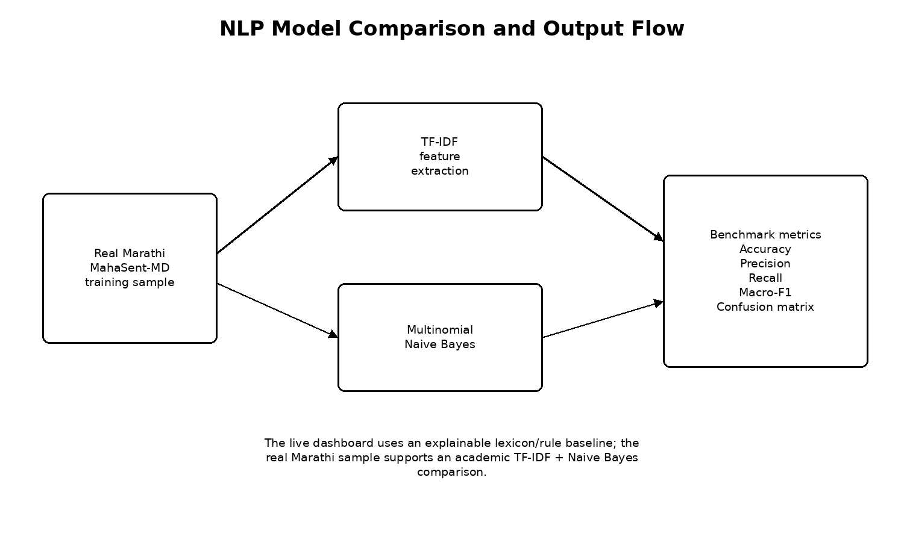
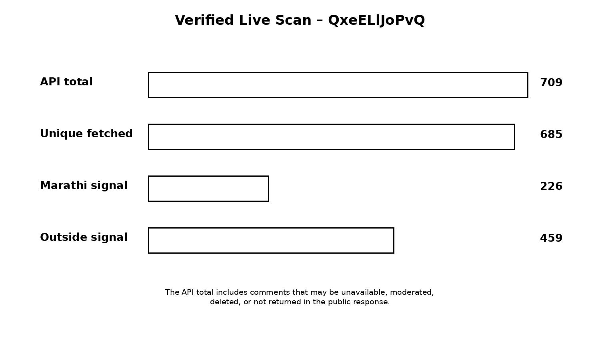

# Screenshots and project figures

These figures are included for the README, academic report, presentation, and viva explanation. They are intentionally minimal and black-and-white to match the supplied academic report format.

## 1. Dashboard overview

The dashboard accepts a YouTube URL and presents the fetched-comment count, sentiment balance, emotion fingerprint, model comparison, preprocessing trace, and downloadable outputs.

## 2. Data collection and NLP pipeline

The pipeline shows the sequence from URL parsing and YouTube API retrieval to pagination, reply deduplication, text cleaning, Marathi-signal detection, classification, and aggregation.

## 3. Architecture

The architecture separates the React client, tRPC/Express server, YouTube Data API, NLP engine, benchmark dataset, and downloadable report outputs.

## 4. Model comparison

The comparison view explains the role of TF-IDF features and the two classical models used for the academic benchmark: Naive Bayes and Logistic Regression.

## 5. Sentiment and emotion chart

This figure represents the dashboard's aggregated sentiment and emotion summaries. Live values change according to the supplied public YouTube video.

> The figures are documentation assets, not hard-coded analysis results. Live counts and charts are produced at runtime.
